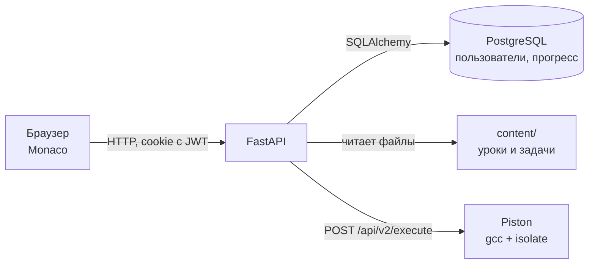

# C-тренажёр

Учебный сайт для языка C: короткие уроки по лекциям и задачи, которые решаются прямо в браузере.
Пишешь код в редакторе VS Code (Monaco), нажимаешь «Проверить» — бэкенд компилирует его в изолированной
песочнице, прогоняет по тестам и показывает, какие прошли, а где вывод отличается от ожидаемого.

Сделано как учебный проект и проект для портфолио (студент 1 курса ИТМО, КТвД).

## Что умеет

- **Аккаунты:** регистрация и вход по email и паролю; прогресс и последний код по каждой задаче хранятся на сервере.
- **Уроки:** 14 уроков по четырём лекциям — базовый синтаксис C, указатели, динамическая память, препроцессор и модульность
  (теория на один экран, примеры, отметка «пройдено»).
- **Задачи:** 36 задач с 1–7 тестами каждая (включая граничные случаи), подсказка, эталонное решение по кнопке.
- **Редактор:** подсветка C, автодополнение и сниппеты (`main`, `for`, `pf`, `sf`…), несколько курсоров,
  поиск и замена, миникарта, горячие клавиши VS Code; `Ctrl+Enter` — запуск, `Ctrl+Shift+Enter` — проверка.
- **Проверка:** ошибка компиляции с текстом gcc, падения с понятным пояснением (SIGSEGV, деление на ноль,
  лимит памяти), превышение времени, первая отличающаяся строка вывода.
- **Интерфейс:** тёмная и светлая темы, вёрстка для телефона.

## Стек

| Часть | Что используется |
|---|---|
| Бэкенд | Python 3.12, FastAPI, SQLAlchemy 2, Alembic, PostgreSQL 16 |
| Вход | argon2 (хэш паролей), JWT в httpOnly-cookie, slowapi (ограничение частоты) |
| Запуск кода | [Piston](https://github.com/engineer-man/piston) в своём контейнере, gcc 10.2 (`-std=c11 -lm`), песочница isolate |
| Фронтенд | HTML/CSS/JS без фреймворков, Monaco Editor, marked + DOMPurify |
| Окружение | Docker Compose: `db` + `piston` + `backend` |
| Тесты | pytest — 80 тестов; отдельные скрипты проверки на живом компиляторе |

## Как это устроено



Путь «Проверить»: браузер → `POST /api/tasks/<урок>/<задача>/check` → бэкенд берёт тесты из `content/`,
запускает первый тест (если код не компилируется — остальные не гоняет), затем остальные параллельно по 4,
сравнивает вывод с ожидаемым, сохраняет попытку в `submissions` и прогресс в `task_progress`.

Браузер никогда не обращается к песочнице напрямую — только через бэкенд, где проверяются вход,
размеры кода и частота запросов.

### Безопасность

- **Пароли** — только хэш argon2. При входе с несуществующим email пароль всё равно проверяется
  по «пустышке», чтобы по времени ответа нельзя было узнать, зарегистрирован ли адрес.
- **Сессия** — JWT в cookie с флагами `HttpOnly` (недоступна JavaScript), `SameSite=Lax` (защита от CSRF),
  `Secure` включается переменной `COOKIE_SECURE` при работе по https.
- **Чужой код** выполняется в песочнице isolate: 2 с процессора, 5 с всего, 128 МБ памяти, без сети,
  вывод до 64 КБ. Песочница проверена набором «злых» программ (`backend/scripts/smoke_runner.py`).
- **Лимиты:** регистрация 5/мин и вход 10/мин с IP; запуск 10/мин и проверка 5/мин на пользователя.
- **Входные данные** проверяет Pydantic (код до 64 КБ, ввод до 16 КБ). Имена уроков и задач в адресе
  проверяются регулярным выражением — через `../` нельзя прочитать файл вне `content/`.
- **XSS:** Markdown уроков очищается DOMPurify, результаты запусков выводятся только через `textContent`.
- **Секреты** — только в `.env`, он в `.gitignore`.

### Решения, которые стоит объяснить

- **Piston вместо внешнего Judge0.** Сайт работает локально: свой контейнер не требует ключей, не имеет
  дневного лимита и не зависит от зарубежных сервисов. Клиент Judge0 оставлен (`RUNNER=judge0`) — оба
  реализуют общий интерфейс `Runner` (`backend/app/runner/base.py`), поэтому замена не трогает остальной код.
- **Контент в файлах, а не в базе.** Урок — это папка с Markdown и JSON; новые уроки появляются без
  миграций и перезапуска, их удобно править и ревьюить в git. В базе только пользователи и прогресс.
- **Тесты задач проверяются дважды:** ожидаемые ответы посчитаны на Python, а эталонные решения на C
  прогоняются через настоящий gcc (`check_solutions.py`); заодно проверяется, что заготовка
  компилируется и сама по себе тесты не проходит.

## Как запустить

Нужны Docker Desktop (запущен) и Git.

```
git clone <адрес репозитория>
cd <папка>
copy .env.example .env
```

В `.env` поменять пароль базы в двух местах (`POSTGRES_PASSWORD` и внутри `DATABASE_URL`)
и вписать `JWT_SECRET` (команда для генерации — в файле). Затем:

```
docker compose up --build -d
```

**Один раз** поставить компилятор C в Piston (~700 МБ с GitHub):

```
curl -X POST http://127.0.0.1:2000/api/v2/packages -H "Content-Type: application/json" -d "{\"language\":\"gcc\",\"version\":\"10.2.0\"}"
```

Проверка: http://127.0.0.1:2000/api/v2/runtimes — в списке появится `c 10.2.0`.
Пакет хранится в томе `piston-packages` и при перезапусках не пропадает.

Открыть http://localhost:8000, создать аккаунт и решать. Документация API — http://localhost:8000/api/docs.

Остановить: `docker compose down` (данные базы и Piston сохраняются в томах).

### Если сеть нестабильная

- Образы `postgres` и `python` берутся с зеркала `mirror.gcr.io` (те же официальные образы Docker Hub).
- pip ставит пакеты с повторами (`--retries 10 --timeout 60`).
- Если Piston не может скачать gcc целиком, пакет можно скачать вручную по адресу из
  `https://github.com/engineer-man/piston/releases/download/pkgs/index`, сверить sha256 оттуда же
  и распаковать в том `piston-packages` (`/piston/packages/gcc/10.2.0`), повторив шаги установщика Piston.

## Проверки

```
docker compose exec backend pytest -q
docker compose exec -e PYTHONPATH=. backend python scripts/smoke_runner.py
docker compose exec -e PYTHONPATH=. backend python scripts/check_solutions.py
```

- `pytest` — 80 тестов: вход и выход, лимиты, загрузка контента, API уроков и задач, клиенты
  Piston и Judge0 на поддельной сети, сравнение вывода. Тесты работают с отдельной базой `ctrainer_test`.
- `smoke_runner.py` — 10 настоящих программ через Piston: ввод-вывод, ошибка компиляции, бесконечный
  цикл, SIGSEGV, деление на ноль, перерасход памяти, длинный вывод, `math.h`, попытка выйти в сеть.
- `check_solutions.py` — все эталоны проходят свои тесты, заготовки компилируются и не решают задачу сами.

## Как добавить урок и задачу

```
content/lessons/<урок>/meta.json         {"title", "order", "source", "hidden"}
content/lessons/<урок>/lesson.md         теория (Markdown)
content/lessons/<урок>/tasks/<задача>/
    task.json      {"title", "order", "hint", "tests": [{"input": "2 3\n", "output": "5\n"}],
                    "template_must_compile": true}   ← false для задач «найди ошибку»
    statement.md   условие (Markdown)
    template.c     заготовка кода
    solution.c     эталонное решение
```

Имена папок — латиница в нижнем регистре, цифры и дефис (`01-intro`). Урок появляется на сайте
сразу; после добавления — прогнать `check_solutions.py`. При сравнении вывода не важны пробелы
в конце строк, пустые строки в конце и `\r\n`/`\n`.

Скрытый урок `00-demo` (`"hidden": true`) — техническая демо-задача, в списке не показывается.

## Структура

```
backend/app/
    main.py           вход FastAPI, подключение роутеров и раздача фронтенда
    config.py         настройки из .env
    models.py         таблицы: users, lesson_progress, task_progress, submissions
    auth/             пароли (argon2), JWT, зависимость «текущий пользователь»
    runner/           запуск кода: base.py (интерфейс), piston.py, judge0.py, checker.py
    content/          чтение уроков и задач из файлов
    routers/          API: auth, run, tasks, lessons
backend/alembic/      миграции базы
backend/tests/        pytest
backend/scripts/      проверки на живом Piston
frontend/             страницы index, lesson, task, login
    css/  js/         base.css — цвета и общие стили; shell.js — боковое меню
    fonts/ img/ vendor/   шрифты, иконки, Monaco, marked и DOMPurify — всё в проекте, без CDN
content/lessons/      уроки и задачи: 01–06 — лекция 1, 07–09 — лекция 2, 10–11 — лекция 3
лекции/               исходные лекции (.docx)
```

## Дизайн

Тёмная тема по умолчанию (есть светлая), салатовый акцент для действий и решённого, лавандовый —
для номеров и ключевых слов, фирменный знак — лента в форме буквы C.
Шрифты Unbounded (заголовки), Golos Text (текст), JetBrains Mono (код).

## Выкладка на сервер

Пошаговая инструкция — [DEPLOY.md](DEPLOY.md). Коротко: VPS с Docker (Piston требует
`privileged`-контейнер, поэтому бесплатные Render/Railway не подходят) и `docker-compose.prod.yml`:
перед бэкендом стоит Caddy с автоматическим https, наружу открыты только 80/443,
cookie только по https, uvicorn с `--proxy-headers` (лимиты по реальному IP посетителя).
`.env` на сервере создаёт `deploy/make-env.sh` со случайными паролями,
компилятор ставит `scripts/install_gcc.py`, резервные копии базы — `deploy/backup.sh`.

## Сторонние материалы

- Шрифты Unbounded, Golos Text, JetBrains Mono — SIL Open Font License 1.1 (через Fontsource).
- Иконки [Tabler Icons](https://tabler.io/icons) — MIT.
- [marked](https://github.com/markedjs/marked) — MIT, [DOMPurify](https://github.com/cure53/DOMPurify) — Apache 2.0 / MPL 2.0.
- [Monaco Editor](https://github.com/microsoft/monaco-editor) 0.52.2 — MIT. В `frontend/vendor/monaco/` только нужные
  файлы сборки `min/vs` (ядро, подсветка C, фоновый поток, иконки, русский перевод) — 4,8 МБ вместо 14.
- [Piston](https://github.com/engineer-man/piston) — MIT.


## Лабораторные работы

Раздел `/labs.html`: один редактор на работу, режим «По шагам», автосохранение,
проверки отдельных функций и всей программы, ручные этапы, скачивание main.c
и отметка о защите. Изменение кода делает прошлые проверки устаревшими.
Условия преподавателя пока не загружены, поэтому список пуст.
Формат материалов описан в [content/labs/README.md](content/labs/README.md).
После обновления применить миграцию 0002: `docker compose exec backend alembic upgrade head`.
